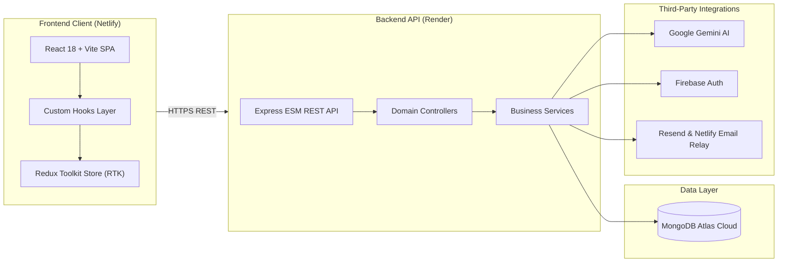

# NOMADLY — Travel Reservation & Trip Management Platform

[](https://nomadly-travel.netlify.app)
[](https://nomadly-travel.onrender.com)
[](https://github.com/Arbaz2402/nomadly-travel/actions)
[](https://github.com/Arbaz2402/nomadly-travel)
[](https://nomadly-travel.onrender.com/api-docs)

NOMADLY is a full-stack travel reservation and collaborative trip planning platform built with **React 18, Redux Toolkit, Node.js, Express, and MongoDB**. It enables travelers to search and book flights, hotels, trains, and buses, manage collaborative group itineraries, track shared expenses, and generate customized trip plans.

---

## 🌐 Live Deployments

| Component | URL | Status | Description |
| :--- | :--- | :--- | :--- |
| **Frontend Web App** | [nomadly-travel.netlify.app](https://nomadly-travel.netlify.app) | 🟢 Live | React SPA with responsive layout, instant checkout, and trip workspace. |
| **Backend REST API** | [nomadly-travel.onrender.com](https://nomadly-travel.onrender.com) | 🟢 Live | Express API with rate limiting, JWT/Firebase authentication, and MongoDB Atlas. |
| **API Documentation** | [nomadly-travel.onrender.com/api-docs](https://nomadly-travel.onrender.com/api-docs) | 🟢 Live | Interactive Swagger OpenAPI 3.0 documentation. |
| **Health Check** | [nomadly-travel.onrender.com/api/health](https://nomadly-travel.onrender.com/api/health) | 🟢 Live | Uptime and service status monitoring endpoint. |

---

## 🚀 Key Features

* **Flight Booking:** Search flights, compare fares, select seats, and lock inventory during checkout.
* **Hotels & Accommodations:** Search accommodations with photo galleries, amenities, and room selection.
* **Trains & Buses:** Authentic IRCTC train schedules and intercity bus seat reservation.
* **Vacation Packages:** Bundled flight and hotel itineraries with scheduled activities.
* **AI Trip Planner:** Generate personalized multi-day itineraries with daily schedules, locations, and Google Maps queries via Google Gemini.
* **Collaborative Trips:** Invite group members with Editor or Viewer roles to collaborate on itineraries and packing lists.
* **Split Expenses:** Multi-currency shared expense tracker with automatic balance settlement.
* **Digital Passes & Receipts:** Boarding passes, QR-validated receipts, and printable PDF invoices.
* **Admin Dashboard:** Booking metrics, revenue analytics, inventory locks, and user governance.

---

## 🏛️ System Architecture



---

## 🚀 Quickstart & Local Development

You can run the entire platform locally in **under 2 minutes** with zero cloud setup required!

### 1. Clone the repository
```bash
git clone https://github.com/Arbaz2402/nomadly-travel.git
cd nomadly-travel
```

### 2. Install dependencies
```bash
npm run install-all
```

### 3. Start Frontend & Backend together
```bash
npm run dev
```
* **Frontend:** [http://localhost:5173](http://localhost:5173)
* **Backend:** [http://localhost:5000](http://localhost:5000)
* **API Documentation:** [http://localhost:5000/api-docs](http://localhost:5000/api-docs)

> [!NOTE]
> **In-Memory Database:** If no `MONGODB_URI` is provided in `.env`, the backend automatically runs an in-memory database pre-seeded with catalog items for zero-config local testing.

---

## 🧪 Automated Testing & CI/CD Pipeline

NOMADLY uses a **100% automated CI/CD pipeline** powered by GitHub Actions. Every Pull Request and commit is tested on clean Ubuntu cloud runners before it can ever be merged.

### Run tests locally:
```bash
# Run all 68 automated tests (Backend + Frontend)
npm test

# Run only backend tests (50 tests with in-memory Mongo)
npm run test:backend

# Run only frontend tests (18 tests with Vitest)
npm run test:frontend
```

### What CI/CD verifies automatically:
1. **50 Backend Tests**: Verifies authentication, booking creation, payment verification, itinerary scheduling, expense settlements, and member invitations.
2. **18 Frontend Tests**: Verifies UI formatting, saved travelers autofill, booking lists, and KPI calculations.
3. **Vite Production Bundle Build**: Compiles 2,750+ modules to guarantee zero syntax errors, missing imports, or bundling regressions.
4. **Branch Protection**: GitHub automatically locks the `main` branch — only code with a 100% green CI test pass can be merged.

---

## 🛠️ Technology Stack

| Layer | Technologies Used |
| :--- | :--- |
| **Frontend UI** | React 18, Vite 5, Tailwind CSS, Lucide Icons, Recharts, Canvas Confetti |
| **Frontend State & Router** | Redux Toolkit (RTK), React-Redux, React Router DOM 6, Custom React Hooks (SRP architecture) |
| **Backend Framework** | Node.js (ESM), Express 4.19, Zod Request Validation, Helmet Security, Rate Limiting |
| **Database & ORM** | MongoDB Atlas, Mongoose 8, In-Memory Mongo Server (Local/CI) |
| **Authentication** | Firebase Cloud Identity, Google OAuth 2.0, JWT Fallback |
| **Generative AI** | Google Gemini 1.5 & Flash-Lite API with structured schema synthesis |
| **Testing Engine** | Vitest 1.6, Supertest, Testing Library (React & DOM), JSDOM |
| **DevOps & CI/CD** | GitHub Actions, Netlify Automated Deploys, Render Cloud Webhooks |

---

## 📁 Clean Architecture Directory Structure

```text
reservation_app/
├── .github/
│   ├── workflows/ci.yml           # Automated CI/CD test & build pipeline
│   └── pull_request_template.md   # Standardized QA checklist for PRs
├── backend/
│   ├── src/
│   │   ├── controllers/           # Modular domain controllers (SRP)
│   │   ├── models/                # Mongoose database schemas
│   │   ├── routes/                # Express API endpoints
│   │   ├── services/              # Pure business logic & AI generators
│   │   ├── utils/                 # Currency rates, settlements, seeders
│   │   └── server.js              # Server entry point
│   └── tests/                     # 50 Automated Vitest test suites
└── frontend/
    ├── src/
    │   ├── components/            # Reusable domain UI components
    │   ├── hooks/                 # Custom React hooks (checkout, trips, AI)
    │   ├── pages/                 # Clean page orchestrators (<250 lines)
    │   ├── services/              # Centralized singleton ApiClient
    │   └── store/                 # Redux Toolkit store (slices, thunks, hooks)
    └── tests/                     # 18 Frontend unit test suites
```

---

## 📄 License
This project is licensed under the [MIT License](LICENSE).
