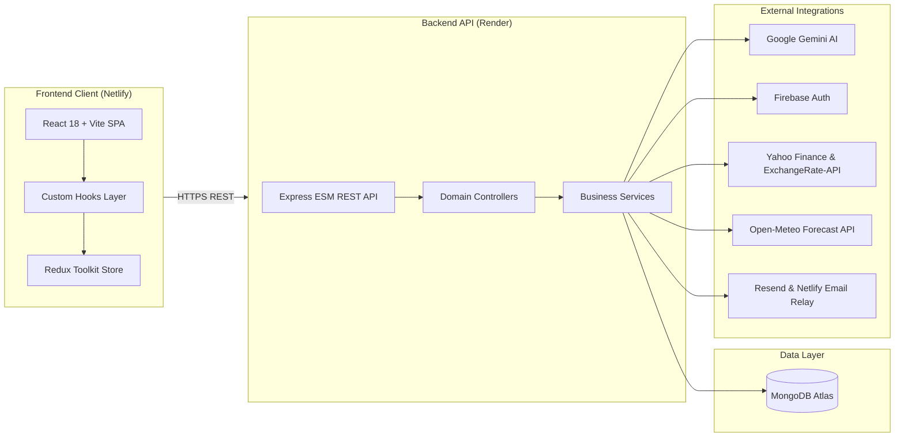

# NOMADLY — Collaborative Trip Planner & Travel Utilities

[](https://nomadly-travel.netlify.app)
[](https://nomadly-travel.onrender.com)
[](https://github.com/Arbaz2402/nomadly-travel/actions)
[](https://github.com/Arbaz2402/nomadly-travel)
[](https://nomadly-travel.onrender.com/api-docs)

NOMADLY is a full-stack collaborative travel planner, group expense splitter, and travel utilities platform built with **React 18, Redux Toolkit, Node.js, Express, and MongoDB**.

---

## Live Deployments

| Component | URL | Description |
| :--- | :--- | :--- |
| **Frontend Web App** | [nomadly-travel.netlify.app](https://nomadly-travel.netlify.app) | React SPA with Journey Workspace, Currency Converter, Packing Checklists, and Trip Planner. |
| **Backend REST API** | [nomadly-travel.onrender.com](https://nomadly-travel.onrender.com) | Express API with rate limiting, Firebase/JWT authentication, and MongoDB Atlas. |
| **API Documentation** | [nomadly-travel.onrender.com/api-docs](https://nomadly-travel.onrender.com/api-docs) | Interactive Swagger OpenAPI 3.0 documentation. |
| **Health Check** | [nomadly-travel.onrender.com/api/health](https://nomadly-travel.onrender.com/api/health) | Service status monitoring endpoint. |

---

## Key Features

* **Collaborative Journey Workspace:** Build day-by-day itineraries with conflict detection, interactive trip maps, calendar view, activity logs, pre-trip readiness score, today's agenda spotlight, and printable PDF trip reports.
* **Group Collaboration & Roles:** Invite companions by email with Owner, Editor, or Viewer roles; pending invitees are excluded from expense splits until they accept.
* **Expense Splitting & Settlements:** Track multi-currency group expenses with equal, exact, percentage, or share-based splits, debt minimization, settlement tracking, and custom settlement reminder emails.
* **Travel Documents Vault:** Upload and preview PDFs and images (passports, boarding passes, confirmations) inline with zoom and rotation.
* **Packing Checklists:** Standalone and journey-synced checklists with customizable templates and clipboard export.
* **Live Currency Converter & Cash Planner:** Live market FX rates with 1D/5D/1M/1Y historical trend charts, a two-way quick conversion cheat sheet, and a daily pocket-cash estimator.
* **Weather & Emergency SOS:** 7-day destination weather forecast with rain alerts via Open-Meteo and quick emergency contacts.
* **Custom Itinerary Planner:** Multi-day itinerary generation via Google Gemini with one-click export into My Journeys.
* **Admin Console:** User governance, journey metrics, tracked expense distribution, and security audit logs.

---

## System Architecture



---

## Quickstart & Local Development

### 1. Clone the repository
```bash
git clone https://github.com/Arbaz2402/nomadly-travel.git
cd nomadly-travel
```

### 2. Install dependencies
```bash
npm run install-all
```

### 3. Start Frontend & Backend together
```bash
npm run dev
```
* **Frontend:** [http://localhost:5173](http://localhost:5173)
* **Backend:** [http://localhost:5000](http://localhost:5000)
* **API Documentation:** [http://localhost:5000/api-docs](http://localhost:5000/api-docs)

> [!NOTE]
> **In-Memory Database:** If no `MONGODB_URI` is provided in `.env`, the backend automatically starts an in-memory MongoDB instance seeded with demo accounts and a sample journey for local development and testing.

---

## Automated Testing & CI/CD

### Run tests locally:
```bash
# Run all 40 automated tests (Backend + Frontend)
npm test

# Run only backend tests (21 tests across 4 suites with in-memory MongoDB)
npm run test:backend

# Run only frontend tests (19 tests across 3 suites with Vitest)
npm run test:frontend
```

### What CI verifies:
1. **21 Backend Tests:** Authentication, journey CRUD, itinerary scheduling, multi-currency expense splitting, debt settlement, collaborator invites, document vault, live currency rates, and admin role authorization.
2. **19 Frontend Tests:** Formatter utilities, admin KPI cards, and core page render smoke tests.
3. **Vite Production Build:** Compiles the production bundle cleanly with zero missing imports or build errors.

---

## Technology Stack

| Layer | Technologies |
| :--- | :--- |
| **Frontend UI** | React 18, Vite 5, Tailwind CSS, Lucide Icons, Recharts |
| **Frontend State & Router** | Redux Toolkit, React-Redux, React Router DOM 6, Custom React Hooks |
| **Backend Framework** | Node.js (ESM), Express 4.19, Helmet, CORS, Rate Limiting |
| **Database & ODM** | MongoDB Atlas, Mongoose 8, MongoDB Memory Server (Local/CI) |
| **Authentication** | Firebase Auth, Google OAuth 2.0, JWT Fallback |
| **AI & Data APIs** | Google Gemini API, Yahoo Finance Chart API, ExchangeRate-API, Open-Meteo |
| **Testing** | Vitest, Supertest, Testing Library (React & DOM), JSDOM |
| **Deployment & CI** | GitHub Actions, Netlify, Render |

---

## Directory Structure

```text
reservation_app/
├── .github/
│   ├── workflows/ci.yml           # Automated CI test & build pipeline
│   └── pull_request_template.md   # Standardized PR checklist
├── backend/
│   ├── src/
│   │   ├── controllers/           # Domain controllers (auth, trips, itinerary, expenses, docs, ai, currency, admin)
│   │   ├── models/                # Mongoose schemas (User, Trip, ItineraryItem, TripExpense, TripDocument, etc.)
│   │   ├── routes/                # Express API routes
│   │   ├── services/              # Email relay, AI prompt service, trip helpers
│   │   ├── utils/                 # Currency rates, settlements, itinerary warnings, seeders
│   │   └── server.js              # Server entry point
│   └── tests/                     # 4 Vitest backend test suites (21 tests)
└── frontend/
    ├── src/
    │   ├── components/            # UI components (journeys, admin, ai, navigation, common)
    │   ├── hooks/                 # Custom React hooks (trips, AI planner)
    │   ├── pages/                 # Route pages (home, journeys, tools, ai, admin)
    │   ├── services/              # Centralized ApiClient & Firebase setup
    │   ├── store/                 # Redux Toolkit store & auth slice
    │   └── tests/                 # 3 Vitest frontend test suites (19 tests)
```

---

## License
This project is licensed under the [MIT License](LICENSE).
