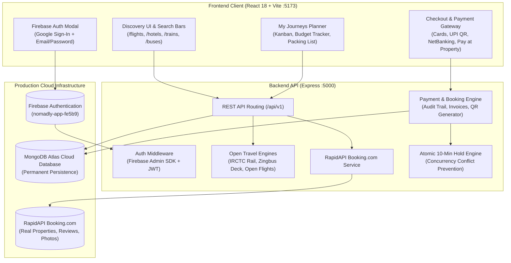

# 🧭 NOMADLY — Production-Ready MERN Travel Reservation Platform

> **"Your entire journey, intelligently organized."**  
> A production-ready full-stack travel booking and itinerary platform built with **React 18, Vite, Node.js Express, MongoDB Atlas, Firebase Cloud Auth, RapidAPI Booking.com, and Tailwind CSS**. Search, compare, hold, book, and orchestrate flights, luxury hotels, express railways, and intercity buses under a unified booking engine.

📚 **Deep-Dive Guides**:
- [🏛️ Full System Architecture & Tech Stack Reference](TECH_STACK_AND_ARCHITECTURE.md)
- [🧪 Testing Tutorial & Automated Test Guide](temp.md)

---

## 🌟 System Architecture & Cloud Integrations



---

## 🚀 Key Production Features

1. **Permanent Cloud Database (MongoDB Atlas)**:
   - Configured with live production cluster (`nomadly` database).
   - Permanent data persistence across all collections (Users, Bookings, Trips, Flights, Hotels, Trains, Buses, Coupons, AuditLogs).
   - Automated parallel-seed lock protection.

2. **Firebase Cloud Authentication (Google Sign-In & Email)**:
   - **Backend**: Firebase Admin SDK initialized with official service account credentials.
   - **Frontend**: One-click Google Sign-In popup via Firebase Web SDK + Email & Password authentication.
   - **Dual-Mode**: Includes 1-click **Traveler** and **Admin** demo personas for instant evaluation.

3. **Live Hotel Discovery (RapidAPI Booking.com)**:
   - Connected with active RapidAPI credentials querying verified real-world properties.
   - Shows authentic traveler reviews, guest ratings, room types, and photos directly from `bstatic.com`.
   - OpenStreetMap (OSM) geographic fallback engine for zero-quota coverage.

4. **Multi-Modal Travel Discovery**:
   - **Flights ✈️**: Standalone flight engine computing authentic schedules across carriers (IndiGo, Air India, Vistara, Akasa Air) for any airport/city pair worldwide. Zero external signups required.
   - **Trains (IRCTC) 🚆**: Official timetable engine generating authentic **Vande Bharat Express**, **Rajdhani Express**, and **Superfast** trains with accurate station codes (`CSMT`, `NDLS`, `SBC`, `MAS`, `MAO`, `BSB`) and class berth allocations (`EC`, `CC`, `1A`, `2A`, `3A`, `SL`).
   - **Buses 🚌**: Generates verified routes for top operators (**Zingbus Electric**, **IntrCity SmartBus**, **VRL Travels**) with **30-seat interactive upper/lower deck layouts**.

5. **Atomic 10-Minute Hold Engine**:
   - Concurrency-safe seat reservation (`InventoryHold`) locks selected seats for 10 minutes.
   - Prevents double-booking collisions while customers complete checkout.

6. **Unified Trip Workspace (My Journeys)**:
   - Multi-segment trip planner with drag-and-drop Kanban boards, day-by-day itineraries, connection gap warnings, real-time budget trackers, and packing checklists.

7. **Production Payment Gateway Sandbox**:
   - Accepts Credit/Debit Cards, UPI QR codes, NetBanking, and Pay at Property.
   - Issues authentic transaction IDs, confirms bookings, creates audit logs, and generates printable/downloadable PDF receipts with verification QR codes.

---

## 💻 Tech Stack

| Layer | Technologies |
| :--- | :--- |
| **Frontend** | React 18, Vite 5, Tailwind CSS, Zustand, TanStack React Query v5, Framer Motion, Lucide Icons, Recharts |
| **Backend** | Node.js, Express.js (ESM), Mongoose 8, Zod, Helmet, CORS, Morgan, Express Rate Limit |
| **Database** | MongoDB Atlas (Cloud) + In-Memory Fallback |
| **Authentication** | Firebase Admin SDK + Firebase Web SDK (Google OAuth + Email) + JWT |
| **Inventory APIs** | RapidAPI Booking.com + OpenStreetMap Nominatim + Open Travel Engines |
| **Testing** | Vitest, Supertest (37 automated tests passing 100%) |

---

## ⚡ Quickstart Guide

### 1. Prerequisites
- **Node.js** (v18+ recommended, tested on v22)
- **npm** (v9+)

### 2. Installation
Install all dependencies across root, backend, and frontend:
```bash
npm run install-all
```

### 3. Environment Setup
Your environment files are already configured with your live **MongoDB Atlas** cluster, **Firebase credentials**, and **RapidAPI key**:
- Root `.env` & `backend/.env`:
  ```env
  PORT=5000
  NODE_ENV=development
  CLIENT_URL=http://localhost:5173
  MONGODB_URI=mongodb+srv://...
  FIREBASE_PROJECT_ID=nomadly-app-fe5b9
  RAPIDAPI_KEY=...
  ```
- `frontend/.env`:
  ```env
  VITE_API_URL=http://localhost:5000/api/v1
  VITE_FIREBASE_API_KEY=...
  VITE_FIREBASE_PROJECT_ID=nomadly-app-fe5b9
  ```

### 4. Run Development Servers
Start both servers concurrently with one command:
```bash
npm run dev
```

- **Frontend Application**: `http://localhost:5173`
- **Backend API**: `http://localhost:5000/api/v1`
- **Health Check**: `http://localhost:5000/api/health`

---

## 🧪 Automated Testing Suite

The project includes 6 comprehensive test suites covering all core services and business logic:

```bash
# Run all automated tests
npm test
```

### Test Coverage (37/37 Tests Passed - 100%):
- `tests/flights.test.js`: IATA airport resolution, airline registry, and dynamic flight generation (8 tests)
- `tests/trains.test.js`: IRCTC timetables, class filters (`EC`, `CC`, `1A`), and stops inspection (4 tests)
- `tests/buses.test.js`: Intercity routes, 10-minute atomic seat hold, conflict rejection, and seat release (5 tests)
- `tests/payments.test.js`: Order creation, sandbox verification, booking status sync, and auth guards (3 tests)
- `tests/journeys.test.js`: Multi-modal trip builder, budget calculation, documents, and itinerary items (7 tests)
- `tests/api.test.js`: Search discovery, rate limiting, and health check endpoints (10 tests)

---

## 📡 API Reference Directory

### Authentication (`/api/v1/auth`)
- `GET /me` - Get authenticated user profile
- `POST /demo-login` - Instant sign-in as Customer or Admin demo persona
- `PUT /profile` - Update display name, phone, preferences
- `POST /travelers` - Add saved traveler for one-click autofill

### Inventory Discovery
- `GET /api/v1/flights/search` - Search flights by origin, destination, cabin class, date, sort
- `GET /api/v1/flights/airports` - List registered airports with city and IATA codes
- `GET /api/v1/hotels/search` - Search live hotels by city, star rating, price, amenities
- `GET /api/v1/trains/search` - Search IRCTC trains by origin, destination, travel class (`EC`, `CC`, `1A`, etc.)
- `GET /api/v1/buses/search` - Search intercity buses with deck maps and pricing
- `POST /api/v1/buses/:id/hold` - Acquire 10-minute atomic seat hold
- `POST /api/v1/buses/:id/release` - Release held bus seats

### Bookings & Checkout
- `POST /api/v1/bookings` - Create reservation with passenger details and price breakdown
- `GET /api/v1/bookings/my` - List current user's bookings
- `GET /api/v1/bookings/:id` - Get booking confirmation and receipt data
- `POST /api/v1/coupons/validate` - Validate promotional discount code (`NOMAD20`, `FIRST10`)

### Payments (`/api/v1/payments`)
- `POST /create-order` - Create secure payment order
- `POST /verify` - Verify transaction, confirm booking, and generate invoice receipt

### Multi-Segment Trip Planner (`/api/v1/trips`)
- `GET /` - List user trips
- `POST /` - Create trip workspace
- `GET /:id` - Get trip with itinerary, expenses, budget, and documents
- `POST /:id/items` - Add flight/hotel/train/bus segment or custom event
- `POST /:id/expenses` - Log trip expense against allocated budget

---

## 🚢 Production Deployment

### Frontend (e.g. Vercel / Netlify / Render)
```bash
npm --prefix frontend run build
```
- Output directory: `frontend/dist`
- Set `VITE_API_URL` to your live backend URL.

### Backend (e.g. Render / Railway / AWS EC2)
```bash
npm --prefix backend start
```
- Set `NODE_ENV=production`
- Add `MONGODB_URI`, `CLIENT_URL`, `FIREBASE_PROJECT_ID`, `FIREBASE_CLIENT_EMAIL`, and `serviceAccountKey.json`.

---

## 📄 License
This project is licensed under the MIT License.
