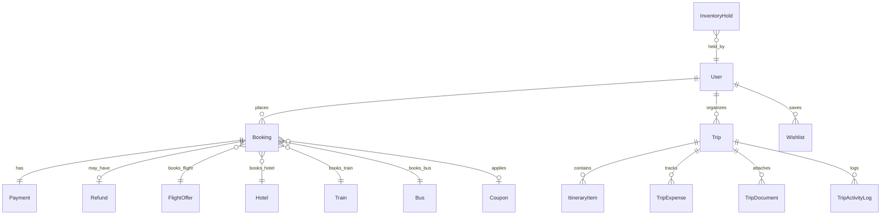
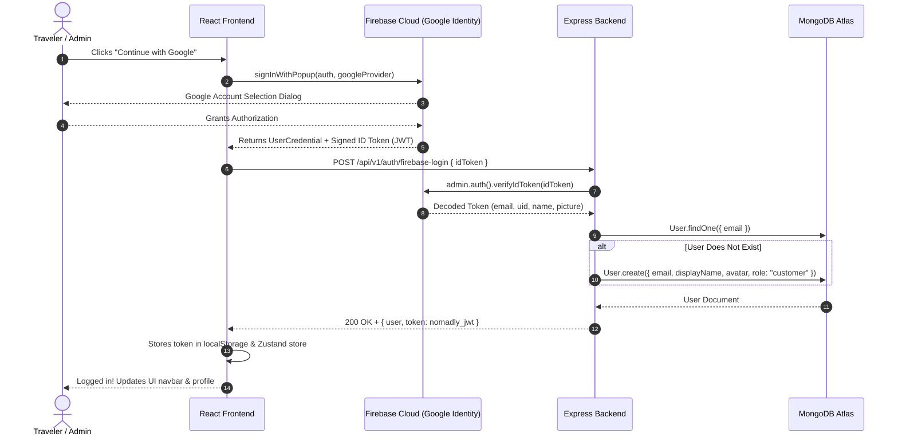

# 🏛️ NOMADLY — System Architecture & Technology Stack Reference

> Comprehensive architectural breakdown of the **NOMADLY** travel reservation platform: cloud databases, authentication workflows, travel data engines, frontend libraries, backend patterns, and data persistence models.

---

## 📑 Table of Contents
1. [High-Level System Topology](#1-high-level-system-topology)
2. [MongoDB Atlas (Database & Persistence Layer)](#2-mongodb-atlas-database--persistence-layer)
   - [Why MongoDB Atlas?](#why-mongodb-atlas)
   - [All 19 Data Models & Collections](#all-19-data-models--collections)
   - [Database Entity-Relationship Model](#database-entity-relationship-model)
3. [Firebase Cloud (Authentication & Identity Layer)](#3-firebase-cloud-authentication--identity-layer)
   - [What Lives in Firebase vs. What Lives in MongoDB?](#what-lives-in-firebase-vs-what-lives-in-mongodb)
   - [Dual-Layer Authentication Workflow](#dual-layer-authentication-workflow)
   - [Step-by-Step Auth Sequence](#step-by-step-auth-sequence)
4. [Travel Data APIs & Supply Engines](#4-travel-data-apis--supply-engines)
   - [Hotels & Stays Engine (RapidAPI Booking.com + Fallback)](#hotels--stays-engine)
   - [Flights Engine (Open Flight Engine)](#flights-engine)
   - [Trains Engine (IRCTC Timetable & Coach Berth Engine)](#trains-engine)
   - [Buses Engine (InterCity GDS & Sleeper Deck Matrix)](#buses-engine)
5. [Frontend Stack & Architecture](#5-frontend-stack--architecture)
   - [Libraries & Packages](#libraries--packages)
   - [Frontend Architecture & Directory Structure](#frontend-architecture--directory-structure)
   - [State Management & Data Flow](#state-management--data-flow)
6. [Backend Stack & Architecture](#6-backend-stack--architecture)
   - [Framework & Core Middleware](#framework--core-middleware)
   - [Backend Directory Organization](#backend-directory-organization)
   - [Concurrency & Atomic Seat Hold Engine](#concurrency--atomic-seat-hold-engine)
7. [Deployment & Infrastructure Topology](#7-deployment--infrastructure-topology)

---

## 1. High-Level System Topology

```mermaid
flowchart TD
    subgraph ClientTier["Frontend Client (Netlify : nomadly-travel.netlify.app)"]
        ReactApp["React 18 + Vite SPA"]
        ZustandStore["Zustand State (Auth & Session)"]
        ApiClient["Singleton ApiClient (Axios/Fetch Wrapper)"]
        FirebaseSDK["Firebase Web SDK 10.11 (OAuth Client)"]
        ReactApp --> ZustandStore
        ReactApp --> ApiClient
        ReactApp --> FirebaseSDK
    end

    subgraph EdgeAuth["Cloud Identity Provider"]
        FirebaseCloud["Firebase Auth Platform (nomadly-app-fe5b9)\n• Google OAuth Popup\n• Cryptographic ID Token Minting"]
    end

    subgraph BackendTier["Backend API (Render : nomadly-travel.onrender.com)"]
        ExpressApp["Express 4.19 REST API (/api/v1)"]
        AuthMid["Firebase Admin SDK 12.0 + JWT Middleware"]
        HoldEngine["Atomic 10-Minute Hold Engine"]
        PaymentEngine["NOMADLY Secure Payment Engine\n(Card, UPI QR, NetBanking)"]
        ExpressApp --> AuthMid
        ExpressApp --> HoldEngine
        ExpressApp --> PaymentEngine
    end

    subgraph DataTier["Data & Cloud Storage Layer"]
        Atlas[("MongoDB Atlas Cloud Cluster\n• 19 Collections\n• Users, Bookings, Trips, Inventory")]
        RapidAPI["RapidAPI Booking.com Live API\n(Real Properties, Reviews, Pricing)"]
    end

    FirebaseSDK -->|1. OAuth Login Popup| FirebaseCloud
    FirebaseCloud -->|2. Returns Signed ID Token| FirebaseSDK
    ApiClient -->|3. POST /auth/firebase-login (ID Token)| ExpressApp
    AuthMid -->|4. Verifies Signature| FirebaseCloud
    ExpressApp -->|5. Find or Create User| Atlas
    ExpressApp -->|6. Search Live Stays| RapidAPI
    HoldEngine -->|7. Concurrency Lock & TTL Index| Atlas
    PaymentEngine -->|8. Store Confirmed Reservation| Atlas
```

---

## 2. MongoDB Atlas (Database & Persistence Layer)

### Why MongoDB Atlas?
- **Cloud-Native & Distributed**: Hosted on Amazon Web Services (AWS) via MongoDB Atlas with continuous backups and zero local database management overhead.
- **Polymorphic Schemas**: Travel items have drastically different metadata (flights have IATA codes, terminals, aircraft models; hotels have check-in/out policies, room amenities; trains have coach classes and berths; buses have sleeper upper/lower decks). MongoDB's BSON structure models multi-modal travel cleanly.
- **Atomic Operations & TTL Indexes**: Uses Mongoose schemas with native TTL (Time-To-Live) indexes for temporary inventory holds that expire automatically without cron jobs.

### All 19 Data Models & Collections

| # | Collection / Model | File Path | What is Stored Here? |
|---|---|---|---|
| 1 | **`users`** (`User`) | `backend/src/models/User.js` | User account records: email, password hash (bcrypt), displayName, avatar URL, role (`customer` or `admin`), loyalty points balance, and embedded subdocuments for saved travelers. |
| 2 | **`bookings`** (`Booking`) | `backend/src/models/Booking.js` | Confirmed travel reservations: unique PNR/reference (`NOM-FL-XXXXXX`), category (`flight`, `hotel`, `train`, `bus`), traveler passenger lists, payment status (`confirmed`, `cancelled`), seat/room assignments, and price breakdowns. |
| 3 | **`inventoryholds`** (`InventoryHold`) | `backend/src/models/InventoryHold.js` | Concurrency lock documents: temporarily holds a specific flight seat, hotel room, or train berth for **10 minutes** during checkout. Has a MongoDB TTL index on `expiresAt` to automatically release seats if abandoned. |
| 4 | **`payments`** (`Payment`) | `backend/src/models/Payment.js` | Payment transaction records: transaction reference, amount paid, currency (`INR`), payment method (Card, UPI QR, NetBanking, Pay at Property), and audit timestamps. |
| 5 | **`refunds`** (`Refund`) | `backend/src/models/Refund.js` | Cancellation records: refund reference, amount refunded, cancellation penalty fee, reason, and status (`processing`, `completed`). |
| 6 | **`trips`** (`Trip`) | `backend/src/models/Trip.js` | "My Journeys" collaborative trip planner workspace: trip title, destination, start/end dates, total budget, privacy mode (`private`, `shared`), linked bookings, and collaborator email list. |
| 7 | **`itineraryitems`** (`ItineraryItem`) | `backend/src/models/ItineraryItem.js` | Granular day-by-day journey schedule: activities, flight times, check-ins, custom notes, times, locations, and status flags. |
| 8 | **`tripexpenses`** (`TripExpense`) | `backend/src/models/TripExpense.js` | Trip budget ledger: expense title, category (`Food`, `Transport`, `Stay`, `Shopping`), amount, who paid, and split calculations. |
| 9 | **`tripdocuments`** (`TripDocument`) | `backend/src/models/TripDocument.js` | Travel documents attached to a trip: boarding passes, hotel vouchers, passport expiry notes, and document URLs. |
| 10 | **`tripactivitylogs`** (`TripActivityLog`) | `backend/src/models/TripActivityLog.js` | Audit trail for a Journey: records when a collaborator added an item, modified budget, or linked a booking. |
| 11 | **`flightoffers`** (`FlightOffer`) | `backend/src/models/FlightOffer.js` | Flight inventory: flight number, airline, origin & destination IATA codes (`BOM`, `DEL`, `BLR`), departure/arrival timestamps, aircraft type, cabin classes (`economy`, `business`), base fare, and live seat matrix. |
| 12 | **`hotels`** (`Hotel`) | `backend/src/models/Hotel.js` | Hotel property catalog: property name, city, star rating, address, coordinates, high-res photos, list of room types (Deluxe, Executive Suite), amenities, base pricing, and policies. |
| 13 | **`trains`** (`Train`) | `backend/src/models/Train.js` | Indian Railways inventory: train number (`22221`), train name (e.g. *Vande Bharat Express*, *Rajdhani*), origin and destination stations, scheduled departure/arrival, coach classes (`1A`, `2A`, `3A`, `CC`, `EC`), and seat layout. |
| 14 | **`buses`** (`Bus`) | `backend/src/models/Bus.js` | Intercity bus routes: bus operator (e.g. *Zingbus*, *IntrCity SmartBus*), bus type (`AC Sleeper 2+1`, `Volvo Multi-Axle`), route, boarding & drop-off points, and interactive lower/upper berth layout. |
| 15 | **`coupons`** (`Coupon`) | `backend/src/models/Coupon.js` | Promotional discount codes: coupon code (e.g. `WELCOME10`, `NOMAD500`), discount type (`percentage` or `fixed`), minimum spend, maximum discount cap, expiration date, and usage count. |
| 16 | **`wishlists`** (`Wishlist`) | `backend/src/models/Wishlist.js` | User's saved favorites: saved hotel properties, flights, or routes bookmarked for future comparison. |
| 17 | **`pricealerts`** (`PriceAlert`) | `backend/src/models/PriceAlert.js` | Price drop tracking: user ID, route or property ID, target price threshold, and notification trigger status. |
| 18 | **`notifications`** (`Notification`) | `backend/src/models/Notification.js` | In-app user notifications: booking confirmations, schedule changes, refund notices, and promotional alerts. |
| 19 | **`auditlogs`** (`AuditLog`) | `backend/src/models/AuditLog.js` | Administrative compliance & security log: records admin actions, inventory overrides, price changes, and critical user operations. |

### Database Entity-Relationship Model



---

## 3. Firebase Cloud (Authentication & Identity Layer)

### What Lives in Firebase vs. What Lives in MongoDB?

| Feature | Handled by Firebase Cloud | Handled by MongoDB Atlas |
|---|---|---|
| **Identity Verification** | Verifies Google account sign-ins & OAuth dialogs | None (delegated to Firebase) |
| **Password Storage** | None (used for Google OAuth; email fallback can be checked) | Stored as salted bcrypt hashes in `User.password` |
| **User Profile & Metadata** | Basic Google claims (`sub`, `email`, `name`, `picture`) | Rich profile, saved travelers, phone, address, KYC |
| **Application Roles** | None | Role-based authorization (`customer`, `admin`) in `User.role` |
| **Bookings & Data** | None | Complete transaction history, journeys, and audit logs |

### Dual-Layer Authentication Workflow

NOMADLY implements a secure **Dual-Layer Token Exchange**:
1. **Frontend Authentication**: The client talks to Firebase Web SDK to handle Google OAuth popups securely.
2. **Backend Verification**: Instead of trusting the client blindly, the frontend sends the signed Firebase ID token to the Express API.
3. **Cryptographic Validation**: The Express backend uses `firebase-admin` (authenticated via `serviceAccountKey.json`) to cryptographically verify Google's signature on the token.
4. **Session Issuance**: Once verified, the backend matches or creates the user in MongoDB Atlas and mints an application session JWT.



---

## 4. Travel Data APIs & Supply Engines

NOMADLY unifies four major travel categories under a single interface:

```
┌──────────────────────────────────────────────────────────────────┐
│                   NOMADLY Unified Search Engine                  │
├───────────────┬───────────────────┬───────────────┬──────────────┤
│ ✈️ Flights    │ 🏨 Hotels         │ 🚆 Trains     │ 🚌 Buses     │
│ Open Flight   │ RapidAPI Booking  │ IRCTC Timetable│ InterCity Bus│
│ Engine        │ + Boutique CRS    │ Coach Engine  │ GDS Matrix   │
└───────────────┴───────────────────┴───────────────┴──────────────┘
```

### Hotels & Stays Engine
- **Live Provider**: **RapidAPI Booking.com Live API**
  - Search endpoint: Resolves city names into Booking.com destination IDs (`dest_id`), then queries live hotel inventory with verified guest review scores, real photo galleries, and real-time room rates.
- **Failover / Boutique CRS Fallback**:
  - If the external API rate-limit is exceeded or a network issue occurs, the system seamlessly falls back to MongoDB Atlas boutique hotel inventory (e.g. *Taj Lake Palace Udaipur*, *Alila Diwa Goa*, *The Oberoi Mumbai*) with zero user-facing errors.

### Flights Engine
- **Provider**: **Open Flight Engine (Deterministic Aviation Engine)**
  - Generates realistic, real-time domestic & international routes (e.g. `BOM` ⇄ `DEL`, `BLR` ⇄ `GOI`, `DEL` ⇄ `DXB`).
  - Calculates dynamic fares based on carrier (IndiGo, Air India, Vistara, Emirates), cabin class (`Economy`, `Premium Economy`, `Business`), time of day, and availability.
  - Generates interactive SVG aircraft seat maps (Rows 1–30 with Window, Middle, and Aisle seating).

### Trains Engine
- **Provider**: **Indian Railways IRCTC Timetable Engine**
  - Features major express routes across India (*Vande Bharat Express*, *Rajdhani Express*, *Shatabdi Express*, *Tejas*).
  - Models realistic coach categories: **1A** (First AC), **2A** (Two-Tier AC), **3A** (Three-Tier AC), **CC** (AC Chair Car), and **EC** (Executive Chair Car).
  - Generates realistic berth allocations (Lower, Middle, Upper, Side Lower, Side Upper) and PNR reservation statuses.

### Buses Engine
- **Provider**: **InterCity Bus GDS Engine**
  - Integrates premier intercity operators (IntrCity SmartBus, Zingbus, SRS Travels, VRL).
  - Renders dual-deck interactive layout: Lower Deck (semi-sleeper seats) and Upper Deck (single and double luxury sleeping berths).

---

## 5. Frontend Stack & Architecture

### Libraries & Packages

| Package | Version | Purpose |
|---|---|---|
| **`react`** & **`react-dom`** | `^18.2.0` | Core UI library using functional components and hooks. |
| **`vite`** | `^5.2.0` | Next-generation frontend bundler providing sub-second HMR and optimized production asset chunking. |
| **`react-router-dom`** | `^6.22.3` | Client-side routing with navigation guards and URL parameter management. |
| **`zustand`** | `^4.5.2` | Minimal, high-performance state store for user authentication and active session management. |
| **`tailwindcss`** | `^3.4.3` | Utility-first CSS framework customized with NOMADLY's Midnight Navy, Vivid Coral, and Teal design system. |
| **`lucide-react`** | `^0.368.0` | Complete suite of lightweight, modern vector UI icons. |
| **`firebase`** | `^10.11.0` | Official Firebase Web SDK for Google OAuth popup handling. |
| **`recharts`** | `^2.12.5` | Data visualization library for interactive budget charts and analytics. |
| **`framer-motion`** | `^11.1.7` | Hardware-accelerated UI animations and modal transitions. |
| **`canvas-confetti`** | `^1.9.2` | Visual celebration animation upon confirmed booking completion. |
| **`react-hook-form`** + **`zod`** | `^7.51.3` / `^3.23.4` | High-performance form handling with type-safe schema validation. |

### Frontend Architecture & Directory Structure

```text
frontend/src/
├── components/             # Reusable UI component modules
│   ├── booking/            # HotelRoomModal, SeatPicker, PriceBreakdown
│   ├── common/             # AuthModal (Portaled), Toast, Button, Input, Modal
│   ├── home/               # FeaturedDestinations, PromotionalBanners
│   ├── journeys/           # AttachBookingModal, ItineraryTimeline, ExpenseTracker
│   ├── navigation/         # Navbar (Responsive Drawer), Footer
│   ├── search/             # UnifiedSearchHero (4-in-1 multi-modal tabs)
│   └── travel-cards/       # FlightCard, HotelCard, TrainCard, BusCard
├── context/                # React Context providers (ToastContext)
├── pages/                  # Route-level view components
│   ├── admin/              # AdminDashboard (Inventory management, audit logs)
│   ├── booking/            # BookingDetailsPage
│   ├── buses/              # BusesPage (Search, filters, sleeper berth picker)
│   ├── checkout/           # CheckoutPage (Traveler forms, coupon engine, payment)
│   ├── confirmation/       # ConfirmationPage (E-ticket voucher, QR code, Confetti)
│   ├── dashboard/          # UserDashboardPage (My bookings, profile, saved travelers)
│   ├── flights/            # FlightsPage (Search bar, quick routes, cabin filter)
│   ├── home/               # HomePage
│   ├── hotels/             # HotelsPage (Search, RapidAPI live stays, room modal)
│   ├── journeys/           # JourneysPage (Collaborative trip workspaces)
│   ├── trains/             # TrainsPage (Station search, coach classes, PNR preview)
│   └── wishlist/           # WishlistPage (Saved favorites & price watchlist)
├── services/               # HTTP client layer (ApiClient, firebase.js)
├── store/                  # Zustand stores (authStore.js)
└── utils/                  # Formatters (formatCurrency, formatDate, validators)
```

### State Management & Data Flow
- **Authentication Store (`authStore.js`)**: Holds current user identity, role, and authentication tokens in `localStorage`.
- **Toast Notifications (`ToastContext.jsx`)**: Context provider rendering notifications across all pages.
- **Service Layer (`ApiClient.js`)**: Centralized HTTP client that attaches `Authorization: Bearer <token>` automatically, handles API errors, and normalizes service URLs.

---

## 6. Backend Stack & Architecture

### Framework & Core Middleware

| Middleware / Library | Version | Purpose |
|---|---|---|
| **`express`** | `^4.19.2` | Fast, minimalist web framework for Node.js REST API endpoints. |
| **`mongoose`** | `^8.3.1` | Object Data Modeling (ODM) library for MongoDB Atlas with schema validation. |
| **`firebase-admin`** | `^12.0.0` | Server-side Firebase SDK for verifying Google OAuth ID tokens. |
| **`jsonwebtoken`** | `^9.0.2` | Mints and verifies application session JWT tokens. |
| **`bcryptjs`** | `^2.4.3` | One-way password hashing for email authentication. |
| **`cors`** | `^2.8.5` | Handles cross-origin requests from Netlify with full preflight support. |
| **`helmet`** | `^7.1.0` | Sets protective HTTP headers (XSS, Content-Security-Policy). |
| **`express-rate-limit`** | `^7.2.0` | Prevents API brute-force and DDoS attacks. |
| **`morgan`** | `^1.10.0` | HTTP request logging for debugging and audit inspection. |
| **`vitest`** + **`supertest`** | `^1.5.0` / `^6.3.4` | Automated test suite (37 tests across 6 suites). |

### Backend Directory Organization

```text
backend/src/
├── config/                 # Environment validation and database configuration
├── controllers/            # Route controllers (Request extraction & response)
│   ├── adminController.js
│   ├── authController.js
│   ├── bookingController.js
│   ├── busController.js
│   ├── flightController.js
│   ├── hotelController.js
│   ├── journeyController.js
│   ├── paymentController.js
│   └── trainController.js
├── middleware/             # Express middlewares (auth.js, admin.js, errorHandler.js)
├── models/                 # Mongoose schemas (19 database collections)
├── routes/                 # Express route definitions mounted on /api/v1
├── services/               # Core business logic & external API clients
│   ├── amadeusService.js   # Open Flight supply engine
│   ├── bookingService.js   # Booking lifecycle manager
│   ├── holdService.js      # 10-Minute atomic concurrency hold engine
│   └── rapidApiService.js  # Live Booking.com API integration
├── utils/                  # Seeding utility (seed.js) & helper functions
└── server.js               # Application bootstrap & listener
```

### Concurrency & Atomic Seat Hold Engine
To prevent two travelers from booking the same seat or room simultaneously:
1. When a traveler enters checkout, `POST /api/v1/bookings/hold` is called.
2. The `InventoryHold` service creates an atomic lock record in MongoDB with an index:
   ```javascript
   inventoryHoldSchema.index({ expiresAt: 1 }, { expireAfterSeconds: 0 });
   ```
3. If another user attempts to hold the same item within the 10-minute window, the API rejects it with `409 Conflict ("Seat is currently held by another traveler")`.
4. If payment completes within 10 minutes, the hold is converted into a confirmed `Booking`.
5. If the user abandons checkout, MongoDB Atlas's TTL background process automatically evicts the hold document, returning the inventory to the public pool.

---

## 7. Deployment & Infrastructure Topology

```
┌─────────────────────────────────────────────────────────────┐
│                   DEPLOYMENT TOPOLOGY                       │
├──────────────────────────────┬──────────────────────────────┤
│ Frontend Deployment          │ Backend Deployment           │
│ • Host: Netlify              │ • Host: Render               │
│ • URL: nomadly-travel        │ • URL: nomadly-travel        │
│   .netlify.app               │   .onrender.com              │
│ • Build Command:             │ • Build Command:             │
│   npm --prefix frontend run  │   npm --prefix backend       │
│   build                      │   install                    │
│ • Publish Directory:         │ • Start Command:             │
│   frontend/dist              │   node backend/src/server.js │
│ • Rewrites: /public/_redirects│ • Health: /api/health       │
├──────────────────────────────┴──────────────────────────────┤
│ Cloud Services                                              │
│ • Database: MongoDB Atlas (M0 Free Cloud Replica Set)       │
│ • Auth: Google Firebase (nomadly-app-fe5b9)                 │
│ • Live Hotel API: RapidAPI Booking.com                      │
└─────────────────────────────────────────────────────────────┘
```

---

## 8. Summary Checklist of Project Credentials

- **GitHub Repository**: [`https://github.com/Arbaz2402/nomadly-travel.git`](https://github.com/Arbaz2402/nomadly-travel.git)
- **Live Frontend**: [`https://nomadly-travel.netlify.app/`](https://nomadly-travel.netlify.app/)
- **Live Backend API**: [`https://nomadly-travel.onrender.com/api/v1`](https://nomadly-travel.onrender.com/api/v1)
- **Firebase Project ID**: `nomadly-app-fe5b9`
- **MongoDB Atlas Cluster**: `cluster0.j4cv3aq.mongodb.net/nomadly`
- **Automated Tests**: 37 / 37 automated tests passing via Vitest.

